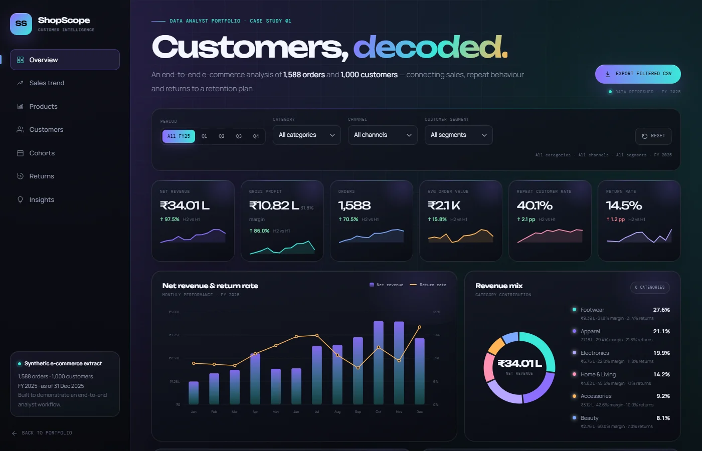

# ShopScope — E-Commerce Sales & Customer Analysis

A data analyst portfolio case study for **NovaCart**, a fictional D2C lifestyle brand. The project turns **1,588 orders**, **1,000 customers** and **231 returns** into a sales, retention and returns story.

**Live dashboard:** [`index.html`](index.html) · **Tools:** SQL Server · Python (pandas) · Power BI · custom SVG dashboard



---

## The business problem

NovaCart was growing revenue but could not answer three questions:

1. **Where is revenue coming from** — category, product, channel and customer segment?
2. **Are customers coming back** — and which segments are worth protecting?
3. **Where is revenue leaking** — which categories and return reasons are hurting margin?

The deliverable is a single decision surface for the commercial and CRM teams, plus a repeatable SQL + Python pipeline.

---

## Headline numbers (FY 2025)

| Metric | Result |
|---|---:|
| Gross revenue | ₹39.84 L |
| Net revenue (after refunds) | ₹34.01 L |
| Gross profit | ₹10.82 L |
| Gross margin | 31.8% |
| Orders | 1,588 |
| Average order value | ₹2,142 |
| Customers | 1,000 |
| Repeat customer rate | 40.1% |
| Return rate | 14.5% (231 orders) |
| Refund value | ₹5.83 L |

---

## What the analysis found

### 1. Revenue is concentrated in footwear and apparel

| Category | Net revenue | Share | Gross margin | Return rate |
|---|---:|---:|---:|---:|
| Footwear | ₹9.39 L | 27.6% | 21.8% | 21.4% |
| Apparel | ₹7.18 L | 21.1% | 29.4% | 21.3% |
| Electronics | ₹6.75 L | 19.9% | 22.0% | 11.8% |
| Home & Living | ₹4.82 L | 14.2% | 45.5% | 7.1% |
| Accessories | ₹3.12 L | 9.2% | 42.6% | 10.0% |
| Beauty | ₹2.76 L | 8.1% | 60.0% | 7.0% |

Footwear and apparel together contribute **48.7% of net revenue** but also carry the highest return rates. Home & Living and Beauty are smaller but much more profitable per rupee.

### 2. Repeat customers are the growth engine

- **40.1%** of customers have ordered more than once.
- Repeat orders contribute **35.7%** of net revenue.
- The top two RFM segments — **Champions + Loyal Customers** — drive **49.0%** of net revenue.
- **At Risk** customers are **220 people (21.8% of revenue)** with an AOV of ₹1,812. This is the highest-leverage win-back audience.

| RFM segment | Customers | Revenue share | AOV | Avg orders |
|---|---:|---:|---:|---:|
| Champions | 121 | 24.1% | ₹2,617 | 3.6 |
| Loyal Customers | 259 | 24.9% | ₹1,973 | 2.3 |
| New / Potential | 141 | 10.6% | ₹2,550 | 1.0 |
| Need Attention | 79 | 6.7% | ₹2,898 | 2.1 |
| At Risk | 220 | 21.8% | ₹1,812 | 2.3 |
| Hibernating | 180 | 11.9% | ₹2,251 | 1.0 |

### 3. Returns are a fit problem, not just a product problem

- **14.5%** of orders are returned; refunds total **₹5.83 L**.
- **Size / fit** is the top reason at **35.9%** of returns.
- Footwear returns **21.4%** of orders and Apparel **21.3%** — both well above the 14.5% brand average.
- Footwear alone accounts for **₹2.47 L** of refunds.

### 4. Cohort retention is strongest in the first three months

Month-1 retention averages **12.1%**, with the best early cohorts retaining **16–27%** by month 3. Retention then flattens — the biggest opportunity is a structured second-purchase journey in the first 90 days, not a broad discount campaign.

### 5. Peak season is Q4

October was the strongest month at **₹4.50 L net revenue**, followed by November (₹4.44 L). The festive window drives volume, but return rates also rise — inventory and size-guide content need to be ready before the peak.

---

## Recommendations

1. **Fix fit before buying more traffic.** Add fit guidance, model measurements and review-led size prompts for footwear and apparel. A 2 pp return-rate reduction on those two categories avoids roughly ₹33 K in refunds; a 10 pp reduction protects about ₹1.7 L.
2. **Run a targeted At Risk win-back.** The 220 At Risk customers hold 21.8% of revenue. A 10% reactivation at their current AOV is worth about ₹40 K in net revenue.
3. **Protect Champions with early access, not discounts.** Champions already have the highest AOV and 100% repeat behaviour. Early access and loyalty perks preserve margin better than blanket offers.
4. **Shift acquisition spend toward high-retention sources.** Organic and Social bring the largest revenue pools; Marketplace has the highest return rate (16.2%) and a lower AOV. Reassess Marketplace economics.
5. **Build the second-purchase journey.** Trigger a personalised recommendation and fit reminder 21–35 days after first delivery. Month-1 retention is the biggest lever in the cohort matrix.

---

## Project structure

```
shopscope/
├── index.html                  Live dashboard
├── case-study.html             Narrative case study
├── styles.css                  Dashboard styling
├── motion.css                  Shared cursor, reveal and tilt motion layer
├── app.js                      Dashboard logic (filters, SVG charts, RFM, cohorts)
├── motion.js                   Shared motion behaviour for both pages
├── data/
│   ├── customers.csv           Raw customer master (1,000 customers)
│   ├── customers_scored.csv    RFM-scored customer dimension
│   ├── orders.csv              1,588 orders
│   ├── returns.csv             231 returns
│   ├── products.csv            24 SKUs
│   ├── summary.json            Machine-readable analysis
│   └── dashboard-data.js       Embedded dashboard payload
├── python/
│   ├── generate_data.py        Deterministic synthetic data generator
│   ├── analyze.py              KPIs, RFM, cohorts, returns, dashboard payload
│   └── requirements.txt        pandas dependency
├── sql/
│   └── ecommerce_analysis.sql  SQL Server 2008 analysis layer
├── powerbi/
│   ├── README.md               Model, report pages and build steps
│   ├── measures.dax            DAX measures
│   ├── powerquery.m            Power Query template
│   └── theme.json              Power BI theme
└── README.md
```

---

## Data model

Star schema:

```
Customers 1 ─── * Orders * ─── 1 Products
                     │
                     │ 1
                     *
                  Returns

Date 1 ─── * Orders
```

`orders.csv` is the fact table. It carries order, customer, product, channel, revenue, refund, profit, return and cohort fields. `customers_scored.csv` is the customer dimension with RFM scores and segments (built by `analyze.py` from the raw `customers.csv`). `returns.csv` is the return fact for reason analysis.

### Key fields

| Table | Field | Description |
|---|---|---|
| orders | `order_sequence` | 1 = first order, 2+ = repeat |
| orders | `is_repeat` | 1 if the order is a repeat purchase |
| orders | `revenue` | Gross order value before refund |
| orders | `refund_amount` | Revenue refunded on a return |
| orders | `net_revenue` | `revenue - refund_amount` |
| orders | `profit` | `net_revenue - cost` |
| orders | `cohort_month` | Month of the customer's first order |
| orders | `cohort_index` | Months between first order and this order |
| customers | `segment` | RFM segment |
| customers | `r_score`, `f_score`, `m_score` | 1–5 RFM scores |

---

## How to run

### 1. Regenerate the data (optional)

```bash
pip install -r python/requirements.txt
python python/generate_data.py
```

This writes `customers.csv`, `orders.csv`, `returns.csv` and `products.csv` using a fixed random seed.

### 2. Rebuild the analysis and dashboard payload

```bash
python python/analyze.py
```

This writes `data/summary.json`, `data/customers_scored.csv` and `data/dashboard-data.js`, including RFM scores, segments and cohort fields.

### 3. Open the dashboard

Open `index.html` directly in a browser, or serve the folder:

```bash
python -m http.server 8000
```

Then visit `http://localhost:8000/projects/shopscope/`.

### 4. Recreate the Power BI report

Follow [`powerbi/README.md`](powerbi/README.md). Load `orders.csv`, `customers_scored.csv`, `products.csv` and `returns.csv`, create the relationships, add the measures from `measures.dax`, import `theme.json`, and build the three report pages.

---

## Data quality

The analysis layer checks:

- 0 duplicate order IDs
- 0 duplicate customer IDs
- 0 missing values
- 0 negative net-revenue rows
- 0 refund mismatches
- 0 orphan returns

---

## Notes

- The dataset is **synthetic** and generated for portfolio demonstration. No real customer or transaction data is used.
- The dashboard is intentionally dependency-free: charts are custom SVG so the project runs offline and deploys as static GitHub Pages content.
- The Power BI folder is a build kit (model + DAX + theme + report spec), not a binary `.pbix`. This keeps the analysis reproducible and reviewable in Git.
- SQL is written for **SQL Server 2008** compatibility, including self-joins for month-over-month growth and `NTILE` for RFM scoring.

---

## Portfolio caption

> **ShopScope — E-Commerce Sales & Customer Analysis.** SQL, Python and Power BI analysis of 1,588 orders and 1,000 customers. Built RFM segments, cohort retention and return-rate analysis; found a 40.1% repeat-customer rate, a 14.5% return rate, and size/fit as the largest return driver. Recommended a fit-content fix, an At Risk win-back play and a 90-day second-purchase journey.
